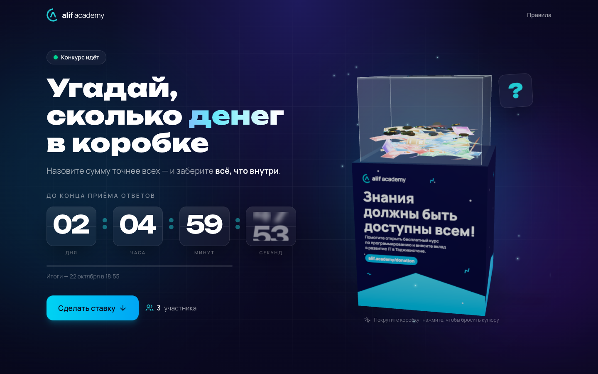
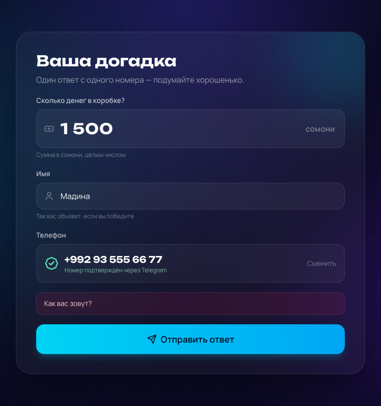
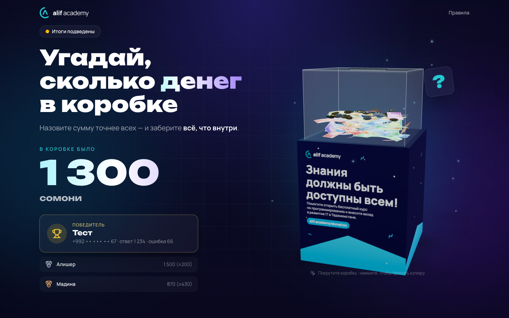
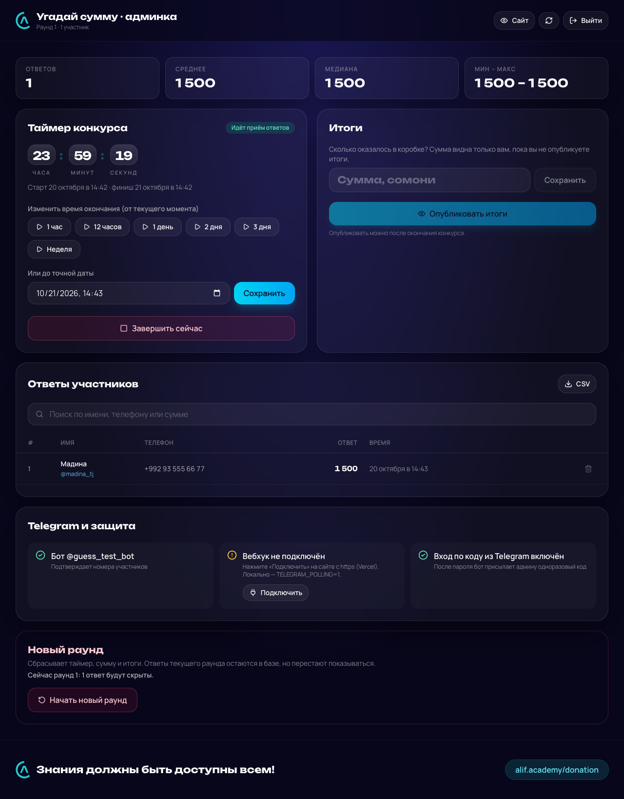

<div align="center">


# Угадай сумму

**Онлайн-конкурс для коробки пожертвований alif academy:
угадайте, сколько денег внутри, — и заберите всё содержимое.**

[**🌐 Открыть сайт**](https://YOUR-PROJECT.vercel.app) · [Как это работает](#как-это-работает) · [Архитектура](#архитектура)



</div>

---

## О проекте

У входа в [alif academy](https://alif.academy) стоит прозрачная коробка для пожертвований с плакатом
«Знания должны быть доступны всем!». Деньги из неё идут на бесплатные курсы программирования
и развитие IT в Таджикистане.

**«Угадай сумму»** превращает эту коробку в игру. Каждый может подойти, присмотреться к купюрам
сквозь стенки и оставить на сайте свою догадку: сколько там сейчас денег. Когда заканчивается
обратный отсчёт, администрация вскрывает коробку, пересчитывает деньги и публикует итоги.
Тот, чей ответ ближе всех к реальной сумме, получает всё содержимое коробки.

### Зачем

- **Больше внимания к коробке и к сбору.** Люди подходят, рассматривают, обсуждают и приводят друзей.
- **Понятный и честный розыгрыш.** Таймер, правила и итоги видны всем. Один человек — один ответ,
  а победитель определяется автоматически по формуле.
- **Минимум ручной работы для академии.** Администрация запускает конкурс в пару кликов, видит все
  ответы в реальном времени и выгружает их в Excel.

## Возможности

**Для участников**

- 3D-модель настоящей коробки: её можно покрутить, а купюры падают в прорезь (клик бросает ещё одну)
- Живой обратный отсчёт до конца приёма ответов
- Подтверждение номера через Telegram-бота в одно нажатие, без ручного ввода и SMS
- Анимированное объявление итогов: реальная сумма, победитель и ещё двое ближайших
- Адаптивная вёрстка: сайт удобно открывать с телефона прямо у коробки

**Для администрации** (`/admin`)

- Запуск конкурса на час, день, неделю или до точной даты; продление и досрочная остановка
- Все ответы в реальном времени: поиск, статистика (среднее, медиана, разброс), выгрузка в CSV
- Ввод реальной суммы → ответы автоматически сортируются по точности, лидер виден сразу
- Публикация итогов на сайте одной кнопкой; новый раунд без потери старых данных
- Вход по паролю и одноразовому коду из Telegram

<table>
  <tr>
    <td></td>
    <td></td>
  </tr>
  <tr>
    <td align="center">Форма ответа с подтверждённым номером</td>
    <td align="center">Объявление итогов</td>
  </tr>
</table>



## Технологии

| Часть | Что используется |
| --- | --- |
| Интерфейс | React 19, Vite, Tailwind CSS 4 |
| 3D и анимации | three.js через @react-three/fiber и drei, Motion, canvas-confetti |
| Сервер | Node.js, Express 5 |
| База данных | PostgreSQL: Neon в продакшене, PGlite (встроенный Postgres) при локальной разработке |
| Подтверждение номеров | Telegram Bot API |
| Хостинг | Vercel: статика и одна serverless-функция |
| Качество кода | ESLint, Steiger (линтер Feature-Sliced Design) |

## Как это работает

### Жизненный цикл конкурса

```
 Админ запускает таймер ──► Идёт приём ответов ──► Время вышло ──► Админ вводит сумму ──► Итоги на сайте
        (idle)                  (running)            (finished)      (рейтинг в админке)      (revealed)
```

1. **Старт.** Администратор выбирает длительность. Сервер сохраняет время начала и конца, и на сайте
   появляется обратный отсчёт. Время всегда берётся с сервера, поэтому неверные часы
   на телефоне участника отсчёт не ломают.
2. **Приём ответов.** Участник вводит сумму и имя и подтверждает номер через Telegram.
   Ответы принимаются только пока идёт таймер.
3. **Финиш.** Форма закрывается автоматически, на сайте появляется надпись «Пересчитываем содержимое коробки».
4. **Подсчёт.** Администратор вводит реальную сумму. Сервер считает разницу для каждого ответа
   и сортирует их. На сайт сумма не попадает, пока её не опубликуют.
5. **Итоги.** После публикации на главной показываются сумма и тройка лучших.
   Номера скрыты, видны только последние две цифры.

**Кто побеждает:** ответ с минимальной разницей `|ответ − реальная сумма|`.
Если разница одинаковая, побеждает тот, кто ответил раньше.

### Подтверждение номера

Номер телефона нельзя вписать руками, его подтверждает Telegram:

```
 Сайт                          Сервер                            Telegram-бот
  │ «Подтвердить номер» ──────► создаёт заявку (token + код)
  │ ◄─── ссылка t.me/бот?start=код
  │ ── открывает бота ───────────────────────────────────────────► /start код
  │                             привязывает заявку к аккаунту ◄──
  │                                                               «📱 Поделиться номером»
  │                             проверяет: свой номер? +992? ◄── контакт
  │ опрос статуса ────────────► verified, номер
  │ «Отправить ответ» (token) ─► тратит заявку, сохраняет ответ
```

- Бот принимает только **собственный** номер аккаунта (пересланный чужой контакт отклоняется)
  и только номера Таджикистана (+992).
- Подтверждение одноразовое и ограничено по времени: 15 минут на подтверждение в боте, затем час на отправку ответа.
- В каждом раунде уникальны и номер, и Telegram-аккаунт, поэтому второй ответ от того же человека не пройдёт.
- Дополнительно действуют лимиты по IP: не больше 10 подтверждений и 8 ответов за 10 минут.

### Защита админ-панели

- **Вход в два шага:** пароль, затем одноразовый 6-значный код, который бот присылает администратору в Telegram.
  Код действует 5 минут, на ввод даётся 5 попыток.
- **Защита от подбора пароля.** Неудачные попытки хранятся в базе, а не в памяти, поэтому лимит общий
  для всех копий serverless-функции. После 5 ошибок с одного IP или 30 ошибок суммарно за 15 минут вход
  блокируется, а каждая ошибка дополнительно замедляет ответ.
- Пароль короче 12 символов не принимается. Сессия подписана HMAC и живёт 12 часов.
- Запросы к вебхуку бота проверяются секретным заголовком Telegram.

## Архитектура

### Общая схема

```
                    ┌────────────────────────── Vercel ──────────────────────────┐
  Браузер ──────────┤  dist/ (статика: React-приложение, 3D-сцена грузится лениво)│
     │              │                                                             │
     └── /api/* ────┤  api/index.js  →  Express-приложение (server/)  ────────────┼──► Neon Postgres
                    │                          ▲                                  │
                    └──────────────────────────┼──────────────────────────────────┘
                                               │ вебхук
                                         Telegram Bot API
```

Фронтенд и бэкенд живут в одном репозитории и деплоятся вместе. Все запросы `/api/*`
обрабатывает одна serverless-функция, внутри которой работает обычное Express-приложение.
Локально тот же Express запускается как сервер, а вместо Neon используется встроенный PGlite,
поэтому для разработки ничего, кроме Node.js, ставить не нужно.

### Фронтенд: Feature-Sliced Design

Код интерфейса разложен по слоям [FSD](https://feature-sliced.design). Каждый слой может импортировать
только слои ниже себя, а в каждый слайс заходят только через его `index.js`.

```
src/
├── app/                  точка входа, роутер, глобальные стили
├── pages/
│   ├── home/
│   │   ├── ui/           HomePage — собирает страницу из разделов
│   │   └── section/      разделы страницы, у каждого свои ui/ и model/
│   │       ├── hero/           заголовок, отсчёт или итоги, 3D-коробка
│   │       ├── guess/          форма ответа
│   │       └── how-it-works/   правила
│   └── admin/
│       ├── ui/, model/   вход, опрос сервера, выполнение действий
│       └── section/      stats · timer · results · guesses · telegram · new-round
├── widgets/              header, footer — общие для сайта и админки
├── features/             действия пользователя:
│                         submit-guess (с подтверждением номера), admin-auth, manage-timer,
│                         set-actual-amount, publish-results, remove-guess, export-guesses, reset-round
├── entities/             бизнес-сущности:
│                         contest (состояние, отсчёт, итоги), guess (статистика, лидер),
│                         donation-box (3D-модель коробки)
└── shared/               api-клиент, утилиты, UI-кит (логотип, карточки, поля), конфиг бренда
```

Правила FSD проверяются автоматически: `npm run lint` запускает ESLint и Steiger.

### Бэкенд

```
server/
├── app.js            маршруты API
├── contest.js        данные конкурса и правила: статусы, рейтинг, маскирование номеров
├── verification.js   заявки на подтверждение номера
├── bot.js            сценарий Telegram-бота
├── telegram.js       обёртка над Bot API
├── auth.js           пароль, коды входа, лимиты попыток, сессии
├── db.js             подключение к Postgres (Neon или PGlite) и схема таблиц
└── local.js          локальный запуск (+ long polling бота)
api/index.js          точка входа serverless-функции Vercel
```

Таблицы создаются автоматически при первом запросе:

| Таблица | Что хранит |
| --- | --- |
| `contest` | текущий раунд, время начала и конца, реальная сумма, опубликованы ли итоги |
| `guesses` | ответы: имя, подтверждённый номер, Telegram-аккаунт, сумма, время |
| `verifications` | заявки на подтверждение номера через бота |
| `admin_challenges` | одноразовые коды входа в админку |
| `auth_failures` | неудачные попытки входа (для блокировки подбора) |

### 3D-коробка

Модель собрана из примитивов three.js по фотографиям настоящей коробки: подставка с плакатом,
акриловый куб с прорезью, внутри купюры сомони и монеты. Плакат, купюры и логотип рисуются
на `canvas` прямо в браузере, поэтому внешние картинки не нужны. Сцена вместе с three.js
вынесена в отдельный чанк и загружается после основной страницы.

## Локальная разработка

Нужен Node.js 22.13 или новее.

```bash
npm install
cp .env.example .env     # впишите ADMIN_PASSWORD
npm run dev              # сайт — http://localhost:5173, админка — /admin
```

Без `TELEGRAM_BOT_TOKEN` номер локально подтверждается заглушкой, в продакшене она отключена.
Все переменные окружения описаны в [.env.example](.env.example), развёртывание — в [docs/deploy.md](docs/deploy.md).

| Команда | Что делает |
| --- | --- |
| `npm run dev` | фронтенд (Vite) и API одновременно |
| `npm run build` | сборка фронтенда в `dist/` |
| `npm start` | сайт и API одним процессом (после сборки) |
| `npm run lint` | ESLint и проверка правил FSD |

---

<div align="center">

**Знания должны быть доступны всем!** · Поддержать бесплатные курсы: [alif.academy/donation](https://alif.academy/donation)

</div>
